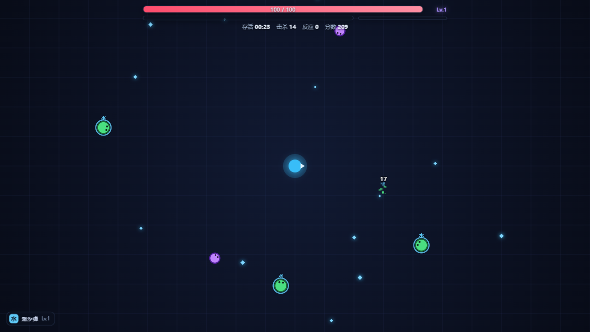
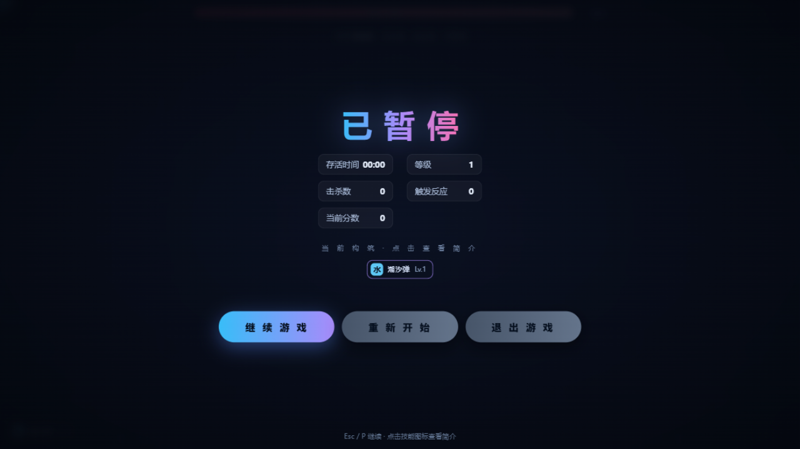
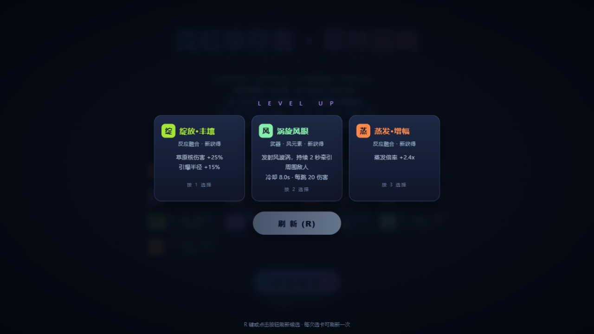

# 元素幸存者 (Element Survivor)

> 一款单文件 HTML5 弹幕生存 Roguelite——攻击全自动，走位定生死，元素反应是灵魂。
> 零依赖、零安装，双击即玩。

[在线试玩](https://\<你的用户名\>.github.io/element-survivor/) · [设计思路](docs/DESIGN.md) · [MIT License](LICENSE)

## 玩法

你会自动攻击，只需专注走位。击杀掉落经验，升级时三选一（可刷新一次）：

- **武器**（最多 6 把，每把 8 级）——每把自带一种元素
- **被动**（7 种）——移速 / 生命 / 拾取 / 伤害 / 攻速 / 回血 / 暴击
- **反应融合**（13 种）——强化元素反应；只在你拥有相关元素后才进入卡池

武器命中给敌人**附着元素**（4.2 秒），换一种元素命中就触发反应：
蒸发、融化、超载、感电、超导、冻结、扩散、结晶、燃烧、绽放、
原激化（超激化 / 蔓激化）、超绽放、烈绽放——**15 种，全部可自然触发**。

敌人也自带原生元素（史莱姆=水、骷髅=冰、电萤=雷……），
开局第一枪就能打出反应，不需要先凑齐两把武器。

## 特性

- 🗺️ **有界大地图**（约 21 屏），被逼进角落就要正面硬拼
- 🎯 **精英怪**：血量 ×3~4.5、部分会远程攻击并与你保持距离
- ⏱️ **成长曲线拉长**：约 24 分钟满级，20 分钟后血量加速膨胀，高手局 20-30 分钟
- 🃏 **卡池过滤 + 刷新**：反应强化只在打得出时出现；每次选卡可 R 键刷新一次
- 🖥️ **单文件、零依赖、无构建**——`index.html` 就是全部（约 75 KB）
- 📱 触屏虚拟摇杆；键盘 `WASD` 移动 · `1/2/3` 选卡 · `R` 刷新 · `Esc` 暂停

## 截图

## 运行

- **在线**：仓库启用 GitHub Pages（Settings → Pages → Deploy from branch → `main` / `(root)`）后，访问上方链接
- **本地**：下载 `index.html`，双击即可（或用任意静态服务器托管）

## 设计

数值曲线、平衡方法与设计取舍见 [docs/DESIGN.md](docs/DESIGN.md)。

## 用代码贡献

欢迎 issue / PR。改数值请同步更新 `docs/DESIGN.md` 中的说明。

## 许可证

[MIT](LICENSE)
